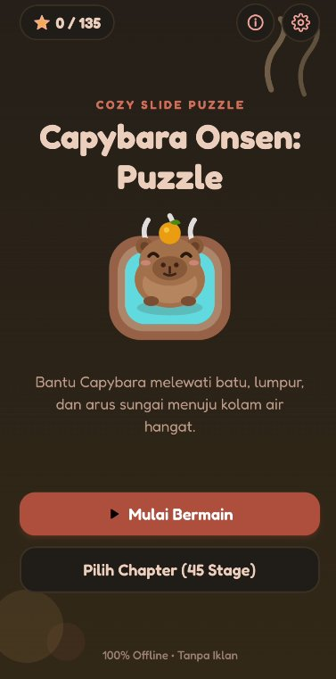
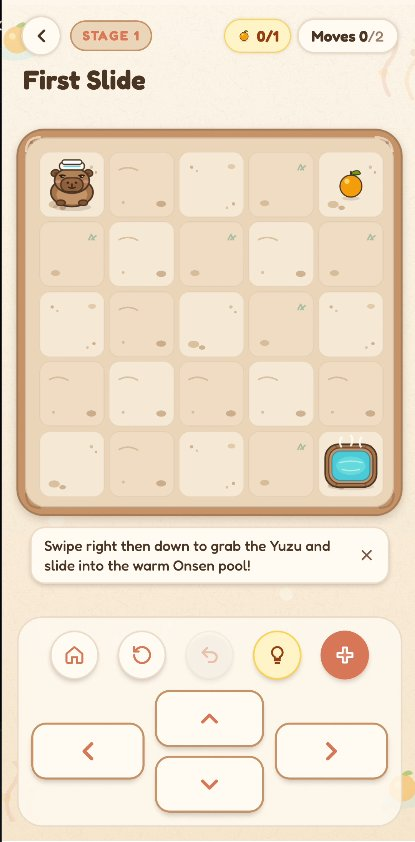
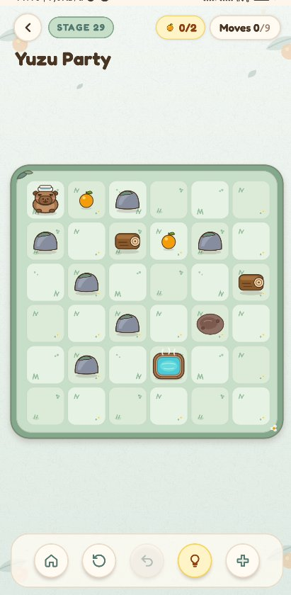
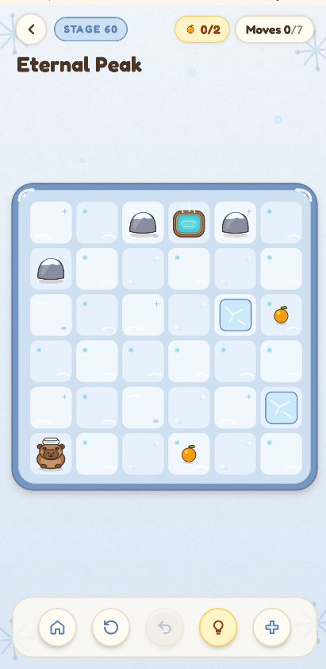
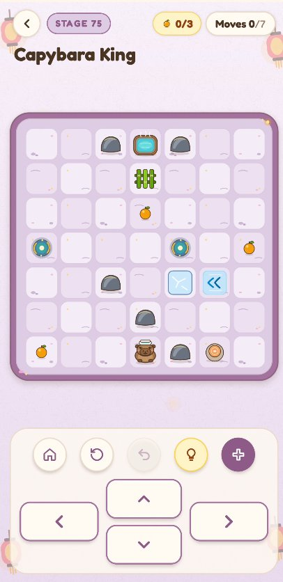
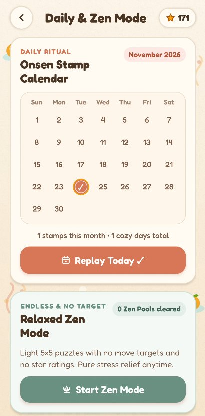
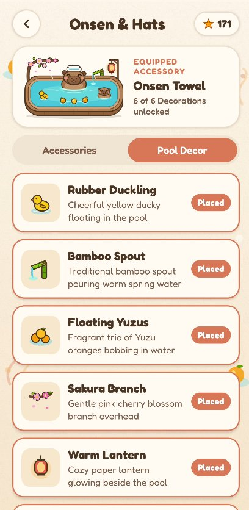
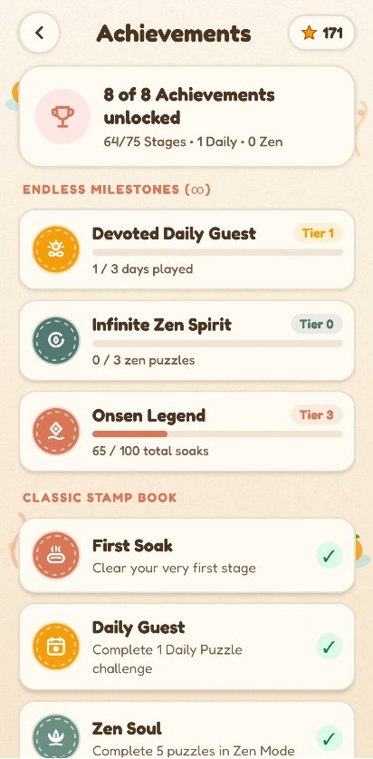

# 🍊 Capybara Onsen: Puzzle (`v1.1.0`)

Game puzzle *slide* santai bertema Capybara yang berjalan **100% offline**, bebas iklan, tanpa akun, dan tanpa izin perangkat yang tidak perlu.

- **Tim Pengembang (Developer):** Pengikut Raja Capybara
- **Penerbit Play Store (Publisher):** Angsa Development Studio
- **Repositori:** [pengikut-raja-capybara/capybara-onsen-puzzle](https://github.com/pengikut-raja-capybara/capybara-onsen-puzzle)

---

## 📱 Tangkapan Layar (Screenshots)

| Menu Utama | Gameplay & D-Pad | Kebun Jeruk Yuzu | Puncak Salju |
| :---: | :---: | :---: | :---: |
|  |  |  |  |

| Malam Lentera | Harian & Mode Zen | Kolam & Dekorasi | Pencapaian (∞) |
| :---: | :---: | :---: | :---: |
|  |  |  |  |

> Materi lengkap untuk publikasi Google Play Store (Deskripsi Indonesia & Inggris, Catatan Rilis `v1.1.0`, Ikon `512×512`, Feature Graphic `1024×500`, serta screenshot promosi berbingkai `1080×1920` di `docs/store-listing/screenshots-id/` & `screenshots-en/`) tersedia di [STORE_LISTING.md](./STORE_LISTING.md).

---

## 🔒 Kebijakan Privasi (Privacy Policy)

Untuk pencantuman URL Kebijakan Privasi di **Google Play Console**, gunakan tautan langsung berikut:

- **Tautan Langsung GitHub (Markdown):**  
  `https://github.com/pengikut-raja-capybara/capybara-onsen-puzzle/blob/main/PRIVACY_POLICY.md`

Lihat isi lengkapnya di [PRIVACY_POLICY.md](./PRIVACY_POLICY.md).

---

## ✨ Fitur Utama (`v1.1.0`)

- **75 Stage dalam 5 Chapter Bertema (termasuk 5 Showcase Finale):**
  1. *Kolam Onsen Hangat* — Tanah hangat, kerikil sungai, batu penghalang & lumpur hangat
  2. *Kebun Jeruk Yuzu* — Rumput kebun & mekanik dorong batang kayu
  3. *Sungai Bambu Tenang* — Rawa sungai, arus air & tombol gerbang bambu
  4. *Puncak Salju Onsen* — Salju musim dingin & es tipis yang retak dan mencair
  5. *Malam Lentera* — Taman batu malam, pusaran portal & kombinasi seluruh mekanik
- **Kolam Onsen Interaktif (6 Dekorasi Kolam):** Sentuh Capybara di layar utama untuk memunculkan partikel hati dan kutipan menenangkan, serta pasang hingga 6 dekorasi kolam (*Bebek Karet, Pancuran Bambu, Yuzu Apung, Ranting Sakura, Lentera Hangat, Anak Capybara*) dengan efek berendam di air.
- **Kalender Stempel *Hanko* Harian & Mode Zen:** Catat hari bermain di kalender tinta *Hanko* bulanan tanpa hukuman *streak* putus, atau bersantai di **Mode Zen** (`5×5` ringan tanpa target langkah maupun rating bintang).
- **Puzzle Harian & Acak:** Tantangan baru setiap hari serta puzzle acak tanpa batas.
- **Koleksi Aksesori, Dekorasi & Pencapaian Tanpa Batas (∞):** Buka topi lucu, 6 dekorasi kolam, 8 stempel klasik bergaya *Goshuincho*, serta **3 jalur target *endless*** (*Tamu Setia Harian*, *Jiwa Zen Abadi*, *Legenda Onsen*) yang terus naik tier selamanya.
- **Solver BFS & Hint Instan:** Petunjuk langkah berikutnya dihitung secara *real-time* dari posisi pemain, disertai pratinjau jalur dan deteksi jalan buntu.
- **Audio & Visual In-App:** Ilustrasi vektor kustom, animasi 60fps (`react-native-reanimated`), musik latar Kalimba unik per chapter, suara alam menenangkan, efek suara lembut, kontrol *swipe* + D-Pad opsional, dan modal *What's New* offline.
- **100% Offline & Privasi Terjaga:** Tanpa koneksi internet, tanpa iklan, tanpa pelacak, dan opsi *Mode Dev* otomatis nonaktif pada *release build*.

---

## 🚀 Cara Menjalankan & Pengembangan

```bash
# Jalankan server pengembangan Expo
npx expo start

# Validasi seluruh 75 stage puzzle (memastikan semua stage solvable dengan BFS)
npm run validate-levels

# Pemeriksaan tipe TypeScript
npx tsc --noEmit

# Regenerasi screenshot promosi Google Play Store (1080x1920 ID & EN)
node scripts/generate-store-screenshots.mjs
```
